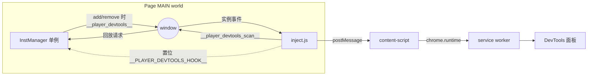
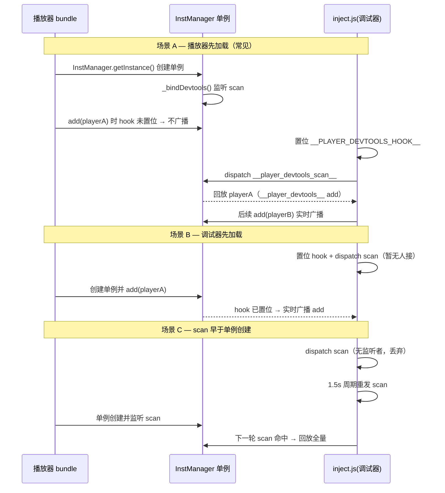

# Player DevTools 实例发现接入点设计（握手门控信标方案）

> 版本：v1 · 2026-10-13
> 适用仓库：`bytedance/xgplayer`
> 关联文档：[devtools-extension-design.md](./devtools-extension-design.md)

---

## 1. 背景与问题

调试扩展需要在任意页面稳定地**发现**页面内所有 xgplayer 实例。现有扩展注入脚本（`inject.js`）采用三级兜底：

1. `InstManager`：通过 `window.Player.instManager` 拿到实例注册表；
2. DOM：扫描 `[data-xgplayerid]` 回查实例；
3. `patchEmit`：monkey-patch `EventEmitter.prototype.emit` 捕获 player-like 发射器。

**三级全部失效的真实案例——某个未向全局暴露 `Player` 的页面：**

| 兜底层 | 失效原因 |
|---|---|
| InstManager | `window.Player / XgPlayer / xgplayer / Xgplayer` 全部 `undefined`，拿不到构造函数，自然拿不到 `instManager` |
| DOM | 能扫到 `[data-xgplayerid]` 节点，但回查实例依赖 `instManager.find()`，IM 拿不到则失败；DOM 节点上只有 React fiber 引用，无实例回引 |
| patchEmit | 既无 IM 又无已注册实例，取不到可 patch 的原型 |

### 根因

实例注册表 `InstManager` 是**模块私有单例**——[instManager.ts](../../packages/xgplayer/src/instManager.ts) 中 `store` 与 `instance` 均为模块级变量，外部唯一入口是 `Player.instManager`。而 `Player` 构造函数是否挂到全局、挂成什么名字，**完全由接入方决定**。接入方不挂全局，调试器就彻底够不着。

此外，`add()` / `remove()` 不派发任何事件，所以即使够到了 IM，也只能靠轮询感知实例增删，无法实时。

> 结论：这不是扩展实现缺陷，而是**播放器没有为外部观察者预留一个与打包方式、业务约定无关的稳定接入点**。依赖 `window.player`、`window.nextPlayer` 等业务对象去"猜"，脆弱且不可移植，已否决。

---

## 2. 设计目标与原则

| 目标 | 说明 |
|---|---|
| **零业务耦合** | 发现实例不依赖 `Player` 是否挂全局、叫什么名、如何压缩混淆 |
| **零生产成本** | 无调试器接入时，播放器侧不产生任何额外开销，不向全局泄露任何实例引用 |
| **实时** | 实例增删即时推送，取代 1.5s 轮询与 monkey-patch |
| **最小改动** | 只改 `instManager.js` 一个文件，`player.js` 及任何现有 API / 全局不动 |
| **向后兼容** | 纯新增，旧版本播放器仍可被扩展现有三级兜底发现 |
| **长期可维护** | 接入点稳定、与打包方式无关，便于长期演进 |

---

## 3. 方案总览

播放器通过 `window` 自定义事件向调试器**单向广播**实例增删，事件 `detail` 直接携带实例引用。调试器无需知道 `Player` 在哪，只需监听事件。三个要素闭合整个链路：

1. **握手门控**：调试器注入脚本在 MAIN world 置位 `window.__PLAYER_DEVTOOLS_HOOK__ = true`。播放器只有在该标记为真时才广播——默认关闭，生产环境零暴露。
2. **信标广播**：`InstManager.add/remove` 时派发 `__player_devtools__` 事件（含 `action` / `playerId` / `player`）。
3. **快照回放**：调试器派发 `__player_devtools_scan__`，`InstManager` 回放当前 `store` 内全部实例——解决"调试器晚于播放器加载"的时序竞态（播放器先于扩展注入的页面正是此种）。



---

## 4. 源码改动：`instManager.ts`

改动落在实例注册表单一文件 [instManager.ts](../../packages/xgplayer/src/instManager.ts)，辅助逻辑全部作为 `InstManager` 的类内私有方法，不新增模块级孤立函数。

### 4.1 新增模块级常量（约定名，与扩展侧共享）

```js
// 调试信标：与 DevTools 扩展注入脚本约定一致，勿改名
const PLAYER_DT_EVENT = '__player_devtools__'      // 播放器 -> 调试器：实例增删
const PLAYER_DT_SCAN = '__player_devtools_scan__'  // 调试器 -> 播放器：请求全量回放
const PLAYER_DT_HOOK = '__PLAYER_DEVTOOLS_HOOK__'  // 调试器置位的握手标记
```

### 4.2 新增 constructor 与两个私有方法

constructor 在实例化时绑定 scan 回放监听；两个私有方法分别负责「监听回放请求」和「广播增删」。关键逻辑如下（环境判空、`try/catch` 等防御性代码从略，详见源码与第 7 节）：

```js
constructor () {
  super()
  this._bindDevtools()
}

// 收到 scan → 回放 store 内全部实例（逐个按 add 广播）
_bindDevtools () {
  window.addEventListener(PLAYER_DT_SCAN, () =>
    this.forEach((player) => this._broadcastDevtools('add', player)))
}

// 仅握手置位时广播；detail 直接携带实例引用
_broadcastDevtools (action, player) {
  if (!window[PLAYER_DT_HOOK] || !player) return
  window.dispatchEvent(new CustomEvent(PLAYER_DT_EVENT, {
    detail: { action, playerId: player.playerId, player }
  }))
}
```

### 4.3 在 `add` / `remove` 末尾挂一行广播

```js
add (player) {
  // ... 原有入库逻辑不变
  this._broadcastDevtools('add', player)       // 新增：入库后广播
}

remove (player) {
  this._broadcastDevtools('remove', player)    // 新增：先广播，后清理
  // ... 原有清理逻辑不变（delete store[player.playerId] 等）
}
```

> `remove` 中广播放在 `delete` 之前，确保 `detail.player` 仍为有效引用。

### 4.4 改动量

| 项 | 数量 |
|---|---|
| 新增模块常量 | 3 行 |
| 新增 `constructor` | 4 行 |
| 新增 `_bindDevtools` | ~8 行 |
| 新增 `_broadcastDevtools` | ~11 行 |
| `add` / `remove` 各加 1 行调用 | 2 行 |
| **`player.js` 改动** | **0** |

---

## 5. 扩展侧改造：`inject.js`

在 [inject.js](../../packages/xgplayer-devtools-extension/src/inject/inject.js) 的发现层新增**最高优先级**的信标发现，现有三级降级为"播放器未升级版本"的兜底。

### 5.1 新增发现函数

最高优先级的信标发现：置位握手标记 → 监听实例事件 → 请求回放（事件监听只绑一次，握手/scan 可重复触发）。

```js
function discoverViaBeacon () {
  window.__PLAYER_DEVTOOLS_HOOK__ = true          // 握手：告诉播放器"有调试器在"
  bindOnce(PLAYER_DT_EVENT, (e) => {                    // 监听增删（d.action: 'add' | 'remove'）
    const d = e.detail || {}
    d.action === 'remove' ? unregisterInstance(playerIdOf(d.player)) : registerInstance(d.player)
  })
  window.dispatchEvent(new CustomEvent(PLAYER_DT_SCAN))  // 请求回放存量实例（覆盖"播放器先"）
}
```

### 5.2 调整 `scan()` 优先级与周期重发

```js
function scan () {
  discoverViaBeacon()                          // 置位握手 + 请求回放（每次重发）
  const found = discoverViaInstManager()       // 兜底：旧版本播放器
  if (!found && instances.size === 0) discoverViaDom()
  patchEmit()
}
```

- `discoverViaBeacon` 幂等：事件监听只绑一次（`bindOnce`），握手标记重复置位无害。
- 周期调用（现有 `setInterval(scan, 1500)`）顺带**重发 scan 事件**，覆盖"调试器注入时播放器单例尚未创建"的极端竞态——播放器 bundle 一旦加载，下一轮 1.5s 内即被回放接住。
- 现有 `pushInstances` / 事件探针 / 指标采集完全复用，`registerInstance` 不变。

---

## 6. 握手时序：三种加载顺序均覆盖



---

## 7. 安全与性能

- **默认关闭**：`_broadcastDevtools` 第一行即校验 `window.__PLAYER_DEVTOOLS_HOOK__`，未置位时立即返回，不构造事件、不暴露 `player` 引用。生产环境无开销、无泄露。
- **单向**：播放器只派发事件、只监听 scan 请求；不接收任何来自页面的指令，无注入面。实例引用仅在 MAIN world 的 CustomEvent 内传递，由同在 MAIN world 的 inject.js 消费，不跨 world 泄露。
- **容错**：`CustomEvent` 构造、`dispatchEvent` 全程 try/catch，老旧或受限环境静默降级，不影响播放。
- **成本可忽略**：仅在 `add`/`remove`（低频生命周期）与收到 scan 时触发，无高频路径介入。

---

## 8. 兼容性与降级

| 场景 | 行为 |
|---|---|
| 新版播放器 + 新版扩展 | 走信标，实时、精准、零猜测 |
| 旧版播放器 + 新版扩展 | 信标无响应，自动降级到 InstManager / DOM / patchEmit 三级兜底（现状） |
| 新版播放器 + 无扩展 | 握手未置位，播放器零开销，行为与现在完全一致 |
| SSR / 无 window 环境 | `_bindDevtools` / `_broadcastDevtools` 首行即返回，不报错 |

> 纯新增、不改任何现有 API 与全局，无破坏性变更。

---

## 9. 落地步骤

1. **播放器内核**：改 [instManager.ts](../../packages/xgplayer/src/instManager.ts)，按第 4 节。
2. **扩展**：改 [inject.js](../../packages/xgplayer-devtools-extension/src/inject/inject.js)，按第 5 节，信标置顶，三级兜底保留。
3. **验证**（见下）。

### 验证清单

- [ ] 单测：`InstManager.add/remove` 在 `window.__PLAYER_DEVTOOLS_HOOK__` 置位时派发 `__player_devtools__`，未置位时不派发。
- [ ] 单测：收到 `__player_devtools_scan__` 时回放 `store` 全量。
- [ ] 本地 fixture（`fixtures/xgplayer`、`fixtures/hls`）：扩展面板实时显示实例增删。
- [ ] 未向全局暴露 `Player` 的页面：面板能发现实例（本方案要解决的核心用例）。
- [ ] 回归：移除握手标记后，播放器行为与改动前一致（无广播、无开销）。
- [ ] 降级：扩展对接未改造的旧播放器包，三级兜底仍工作。
```
