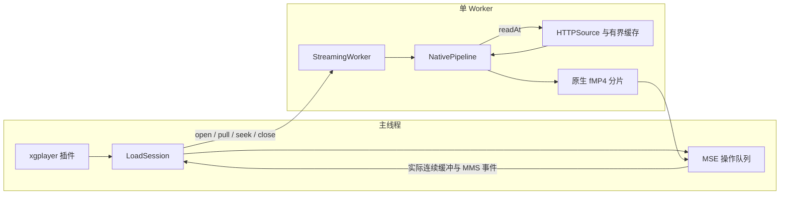

# FFmpeg 与 MSE 架构设计

本文作为 `xgplayer-ffmpeg` 重新实现的设计基准。设计允许重新定义内部接口、核心构建和输出策略，以 HTTP 按需读取、持续播放、随机 seek 和 MSE/MMS 缓冲恢复为目标。

开源事实、固定源码版本和已完成的实验见[开源方案评估](./OPEN-SOURCE-MSE.md)。本文中的预算是本项目的设计决定，不代表普适最优值。

当前已按此方向重写单音轨实现：FFmpeg 8.0 原生库、小型桥接、常驻 Worker、有界 Range、原生 Seek 和 MSE 需求循环均已落地。真实 WASM 已验证 WMA、FLAC 与显式 PCM；独立 Chrome 已验证按需加载、暂停背压、前后及连续 Seek、源切换、EOS 和 EOS 后回跳。Safari/MMS 实机、低端设备资源和跨 Seek 接缝的听感仍待验证，具体证据及限制见开源评估中的[新核心验证](./OPEN-SOURCE-MSE.md#新核心与-chrome-验证)。

## 1. 架构决定

采用 **定制 FFmpeg 库 + 小型原生桥接 + 单 Worker + MSE 驱动的分片拉取**。

FFmpeg 的解复用、必要的解码与编码、重采样和 fMP4 封装都在原生侧连接；Worker 内的 TypeScript 提供有界 HTTP 文件和调用调度。主线程只管理媒体绑定、实际缓冲需求、用户操作和 SourceBuffer 队列。

选择这个方向的理由是职责闭合：FFmpeg 已经拥有输入格式、时间定位、包时间与封装信息，将它们留在同一原生会话可以减少重复适配。我们承担小型原生 API 和构建的维护责任，不据此承诺性能一定优于 libav.js。

libav.js 用于参考异步读取、错误和资源所有权设计；libav-wasm 用于参考 AVIO、常驻输入和原生分片；libmedia 与 hls.js 用于参考需求驱动调度。生产路径不需要把这些播放器或绑定库全部引入，也不需要同时维护多个处理后端。



## 2. 借鉴哪些做法

| 来源 | 借鉴的做法 | 在本项目的落点 |
| --- | --- | --- |
| FFmpeg 官方 AVIO | 自定义读取与 seek 回调，使用标准解复用 API | 不实现 ASF、FLAC 等格式专用 Header 或时间索引 |
| libav-wasm | 常驻输入上下文、原生处理与完整分片 | 普通 seek 保留输入和索引，重建必要的处理状态 |
| libav.js | 异步读取必须恢复同一次原生调用，区分 EOF、取消与错误 | 明确 I/O 返回约定和被取消上下文的恢复 |
| libmedia | 有限 Range、packet pull、媒体缓冲高低水位 | MSE 需求关闭后不再发起下一次生产和下载 |
| matroska.js | 按轨选择透传或转码 | 已支持的 codec 尽量保留，不默认重新编码全部轨道 |
| movi-player | 文件读取能力与媒体处理解耦 | `readAt`、长度、缓存与资源版本属于输入源 |
| hls.js | 缓冲操作串行、回收后重新评估、MMS seeking 边界 | 用实际 TimeRanges 产生补缓冲需求 |

借鉴接口与原则，独立实现边界。参考实现的 `SEEK_END` 分支使用 `size - offset`；我们的标准文件语义使用 `size + offset`。不沿用其初始化字节缓存、固定大内存或对视频轨的依赖。

## 3. 资源所有权与生命周期

只建立以下主要资源所有者；epoch 和请求身份是数据，不另建加载、Seek 或补洞控制器。

| 对象 | 职责 | 生命周期 |
| --- | --- | --- |
| `LoadSession` | 用户意图、当前源与 epoch、拉取循环、MSE 操作协调 | 一次媒体源加载 |
| `MSEBuffer` | SourceBuffer 队列、parser 与时间属性、清理、duration、EOS | 一次媒体绑定 |
| `StreamingWorker` | 核心加载、串行原生操作、控制消息、失败恢复 | 一个播放器实例 |
| `HTTPSource` | 资源长度与版本、有限 Range、缓存、在途请求 | 一个固定媒体源 |
| `NativePipeline` | AVIO、解复用、轨道处理、时间轴、muxer、原生缓冲 | 一个固定媒体源 |

Worker 和 WASM 实例可跨源加载复用。源切换先取消旧操作并关闭旧输入、codec、muxer 和缓存，再打开新源；新媒体绑定按输出轨道创建。普通 seek 不更换 Worker、输入解复用器或媒体绑定。

关闭按实际资源释放顺序执行，重复关闭无副作用。取消不能可靠退出、WASM trap 或内存状态不可恢复时终止 Worker，并使本次操作明确失败；终止是故障边界，不是普通 seek 策略。

原生资源由原生类持有和释放，JS 不访问 FFmpeg 结构偏移。所有输出缓冲明确释放；缓存不跨不同 URL、鉴权配置或资源版本共享。

## 4. 播放契约与 Worker 协议

高层播放接口保持小而明确：

| 操作 | 输入与结果 | 约束 |
| --- | --- | --- |
| `open` | 源、输入参数、输出策略、浏览器能力 → 媒体与输出信息 | 探测有字节与时间预算；不为取得时长全量扫描 |
| `pull` | 当前 epoch 的生产需求 → 一个完整分片或明确 EOF | 一次至多有一个未完成拉取；内部可以分多个原生批次 |
| `seek` | 源时间上的目标 → 新 epoch 的定位与输出信息 | 只表示处理状态已定位，不表示目标已可播放 |
| `close` | 关闭当前源 | 释放读取、等待和原生资源 |

打开时在受控阶段选择输出：当前单音轨版本由主线程预先检测 AAC 与 FLAC 的 MSE/MMS MIME，并在 `open` 请求中携带能力；原生探测实际 codec 后由 Worker 选择透传或编码。没有等待主线程能力回复的原生调用。将来增加动态候选时，能力回复必须能在 `open` 等待时处理，不排在等待它的操作之后。

控制消息包含单调递增的 `epoch` 和操作 `id`；源切换也推进同一个 epoch。主线程加载会话身份与 Worker 操作身份共同隔离旧源。旧输出在进入 MSE 队列和实际执行时都检查身份。HTTP 数据读取在 Worker 内完成，不让每次 AVIO read 往返主线程。

**取消消息不是另一条原生调用。** 收到取消或新 seek 时立即更新 JS 操作状态、中止等待中的请求；待当前原生调用退出后才执行 seek、close 或新 open。不能在 Asyncify/JSPI 挂起时重入同一实例。

## 5. HTTP 文件与字节预算

### 文件契约

```ts
interface SourceFile {
  readonly size: number
  readAt(
    offset: number,
    length: number,
    signal: AbortSignal
  ): Promise<Uint8Array<ArrayBuffer>>
  close(): void
}
```

大小、偏移和长度使用安全整数；FFmpeg 内部保持 64 位位置，跨边界检查表示范围。`readAt` 不改变其他读取者的位置，允许在块边界短读。真实 EOF 返回空数据；取消、网络失败和预算不足分别返回明确错误。

首个完整功能版本以可随机读取的 HTTP(S) 文件为能力基准。服务器必须提供有效 Range 和可确定长度。单响应顺序流如需保留，使用独立的 stream 能力和明确配置，只承诺已缓冲范围内 seek；不静默回退后继续宣称随机 seek 与严格下载控制。

### 请求与缓存

- 首次请求有限的头部范围；优先通过 `Content-Range` 确定长度，头被 CORS 隐藏时可以使用 HEAD 补充长度。
- 缺失读取按块对齐请求，满足当前位置后才请求下一个块；不做全文件预取。
- 相同在途块共享请求。取消后无活跃消费者的请求中止，完整且已验证的缓存块可保留。
- 缓存按 LRU 淘汰。头部和尾部索引块如果保留，也计入同一预算。
- 普通缓冲背压停止下一次拉取，当前有限请求允许完成；取消立即中止当前请求。

以下为初始内部策略，需实际校准，不作为已测量的普适最优值：

| 预算 | 初始策略 | 限制内容 |
| --- | --- | --- |
| Range 块 | 128 KiB | 一次普通请求的响应范围 |
| 源缓存 | 8 MiB | 已验证源字节，不包括 WASM 与媒体内存 |
| 请求并发 | 1 | 避免无需求的推测预取 |
| 原生输入缓冲 | 64 KiB | 一次 AVIO 字节供给与复制 |
| 打开源下载 | 256 KiB，可明确调整 | 包括头尾读取与格式探测 |
| seek 新增下载 | 4 MiB，可明确调整 | 包括索引、搜索和首个目标分片准备 |

打开和 seek 还必须有耗时及处理预算；缓存命中不能导致无限原生扫描。预算不足明确失败，不伪装 EOF、不自动从头转码。文件总长度限制是独立业务策略，不作为缓存上限，也不要求把完整文件装入内存。

### 响应验证

Range 会话验证 `206`、起止范围、总长度和实际字节数。隐藏 `Content-Range` 的兼容路径验证已知长度、状态和预期响应大小，明确依赖服务器遵守 Range 语义。

收到 `200`、错误范围、超量或截断正文时及时取消，不先收齐完整响应。资源期间需要稳定的字节表示，避免 HTTP 内容编码改变文件偏移。有效位置收到 `416` 作为异常；已知 EOF 在本地处理。

可读取的强 ETag 与 `If-Range` 用于资源一致性验证，要求相应 CORS 配置。缺少验证信息时只承诺固定 URL 在会话期间内容不变；发现版本变化立即结束旧源，不能混合新旧缓存。

## 6. 原生桥接与可中断处理

使用 `avio_alloc_context` 连接 `read_packet` 和标准 seek 回调，并通过 `avformat_open_input`、受预算约束的 `avformat_find_stream_info` 获得媒体信息。

输入 seek 回调正确处理 `SEEK_SET`、`SEEK_CUR`、`SEEK_END`、`AVSEEK_SIZE` 和适用的标志位。只改变字节游标，真正 read 才访问 HTTP。每个 AVIO 的游标独立，读取与 seek 使用同一个游标定义。

原生 `read_packet` 收到空数据时返回 `AVERROR_EOF`；取消返回约定的取消错误，其他失败保留具体原因。初始化失败释放部分资源，不能继续使用被 FFmpeg 释放的上下文。

### 一次 pull 不等于一次不可中断的大调用

Worker 将一次 `pull` 拆为有界原生批次。每批限制 packet 数、输入包字节、frame/FIFO 占用，达到边界后返回 Worker；JS 主动让出事件循环，检查最新 epoch，再执行下一批。批次使用真实处理状态继续，不重启 codec。

I/O 等待通过 Asyncify 或 JSPI 恢复同一次原生调用。缓存命中不会产生 I/O 等待，因而不能只依靠 fetch 让出控制。格式打开与复杂定位还需原生 interrupt 检查及等待桥接的协作式让出。

单个 decoder 调用本身可能超过期望时间，批次预算不是硬实时保证。主线程用故障超时检测无法退出的 Worker；普通音频场景通过实际批次成本校准。

### 内存与输出

packet、frame、重采样缓冲和 PCM 留在 WASM 内。只输出媒体信息、完整分片和必要状态。

原生输出内存不能直接作为可转移的 WASM heap 发送。Worker 拷贝一次到独立 ArrayBuffer，释放原生输出，再 transfer 到主线程；不声称整个链路零复制。

NativePipeline 只保留当前分片和有界处理队列，Worker 不积压多个未追加分片。MSE 队列积压不转换为隐蔽的输出预取。

## 7. 输出计划、分片与源时间

### 按轨选择处理路径

输出计划根据实际 codec、浏览器支持、muxer 能力和业务要求建立：

```text
可直接封装且允许保留原编码 → packet 透传 → fMP4
否则                     → 解码 → 必要格式转换/重采样 → 编码 → fMP4
```

新设计以 `auto` 为输出策略方向，AAC-LC 为音频兼容输出。FLAC 能被目标 MSE 正确播放时可透传；WMA 与裸 PCM 进入编码路径。AAC 的采样率、声道和码率由明确的输出策略决定，不将固定 48 kHz、双声道当作所有输入的必然要求。

先交付单音轨 WMA / FLAC / 显式参数 PCM。保留按轨计划的结构，为视频透传及必要转码提供扩展位置；不提前实现字幕、软解渲染或多种硬件后端。

### 原生封装

采用 FFmpeg 原生 MP4 muxer 与不可 seek 输出 AVIO。以 `frag_custom` 和明确 fragment flush 控制完整分片，初始化段与媒体段具有独立结果类型。分片返回完整边界，不能以某次 write 回调或任意 64 KiB 消息作为分片。

音频按实际 packet 时长截段。未来视频同时考虑关键帧、GOP 和解码依赖；不能用强制短段破坏可解码性，也不能放任长 GOP 使处理预算失效。

普通追加维持 encoder 和 muxer 状态。只有 seek 或确定需要重建处理时间段时重新创建；不每几秒独立运行一次 FFmpeg 再拼接。

### 共同源时间

源时间原点从原生媒体和轨道时间建立，在同一源中固定。seek 不重新定义原点；未来多轨保留轨间偏移，不各自从首包归零。

编码帧时间由解码内容的 PTS、样本数和重采样状态建立，输出以真实 packet PTS/DTS、duration 和 time base 为准。不能靠包计数、网络进度或目标 seekTime 推导整个时间轴。

原生 muxer禁止隐式归零或不受控的 edit-list 时间转换。需要处理负 DTS 时，根据实际首包时间建立共同偏置：

```text
fMP4 时间 = 源时间 + epochBias
SourceBuffer.timestampOffset = -epochBias
```

偏置仅应用一次；已经非负的时间无需为 seek 人工减去目标时间。候选 mux 配置为 `empty_moov + default_base_moof + frag_custom + frag_discont`，明确控制 `use_editlist` 和 `avoid_negative_ts`。参数是实现手段，正确的包时间与浏览器输出才是验收依据。

时长从 AVFormatContext / AVStream 取得，通过 MSE API 设置。未知时长保持未知，到真实 EOF 再确定；不追加 FFprobe 任务、不改写输出 MP4 box。

## 8. seek、音频预滚与取消

### 处理状态重置

未缓冲 seek 依次执行：

1. 更新 epoch，立即使旧输出失效并取消当前读取。
2. 等待原生批次退出和已开始的 MSE 操作完成，清除未执行的旧追加。
3. 丢弃旧 packet、frame、FIFO 与未完成分片；清理 AVIO 的取消/error/EOF 状态。
4. 在已有解复用上下文上按正确 time base 执行原生 seek。
5. flush 或重建 decoder，重建有历史状态的 resampler、encoder 和 muxer。
6. 处理目标附近必要的预滚，建立新输出时间与窗口，追加新 init 和媒体。
7. 以实际 buffered、媒体就绪和最新用户意图确认恢复。

`avformat_seek_file` 成功不等于第一个目标样本已生成。不能假定 `avcodec_flush_buffers` 足以复用任何 encoder。取消留下的 `AVERROR_EXIT` 也不能交给普通 seek 自动清除。

快速连续 seek 只执行最新目标。源切换的优先级高于旧源 seek。失效 epoch 的完整缓存块可以保留，但媒体、错误回调和播放恢复不能作用到新 epoch。

### 音频的三个时间

必须区分 **解码起点、有效呈现起点和用户目标**。decoder 需要的预滚、encoder priming、末尾 padding 和 source PTS 分别处理。

不能一律将 `appendWindowStart` 设置为用户目标并丢弃所有此前编码包：跨窗口的音频帧、解码准备和有效样本可能同时被截掉。输出记录经过原生处理的安全追加边界；用户 currentTime 仍指向请求目标。

当前缺口补充还要与已缓冲岛的安全边界衔接。必要时生成受控重叠并按实际帧和可用 padding 信息处理，而不是重复播放或人为合并 TimeRanges。首个编码包的时间与边界听感必须用实际解码验证，不硬编码 1024 samples 或任意 1 秒补偿。

任意 codec 的样本级无缝跨 epoch 拼接不是初始承诺；首先保证内容与时间正确、目标可播放，连续补充不引入重复或扩大 gap 容忍。

## 9. MSE/MMS 需求调度

LoadSession 维护一个拉取循环，依据当前位置所在的连续缓冲区计算前向剩余。初次播放、用户 seek 和 MMS 回收产生同一种目标需求；不分别建立加载、seek 与补洞控制器。

高水位为 `bufferAhead`，低水位初始取高水位的一半。达到高水位停止下一次 pull，低于低水位恢复；暂停也只填充固定窗口。分片可以造成有限超量，媒体时间预算与 HTTP 字节预算独立核算。

| 场景 | 操作 |
| --- | --- |
| 目标在当前连续缓冲且生产位置匹配 | 直接播放并重新评估水位 |
| 目标在其他已缓冲岛 | 使用已有数据；停止不匹配的生产，必要时定位该岛末尾 |
| 目标未缓冲或当前需要区间被回收 | 执行同一个原生定位与补充流程 |
| 后续缓冲岛已存在 | 补充以它的安全边界为终点，需求覆盖后停止 |
| 仅历史无用区间被删除 | 清理状态，不启动转码重建 |

MSEBuffer 串行执行 append、remove、parser reset、timestampOffset、append window、duration 和 EOS。时间属性使用标准精确值，不沿用隐式 1 ms 修正；abort 之后重设窗口。已经开始的旧操作无法回滚，先等待它结束，再在新 epoch 边界处理必要重叠。

普通 `endstreaming` 停止额外生产。参照 hls.js 的 seeking 处理，对最新未缓冲目标允许有预算限制的首个可播放窗口准备；目标就绪后立即恢复普通 MMS 策略，不无限忽略 streaming 状态。

`BUFFERED_CHANGE`、`waiting`、`startstreaming` 和主动 remove 后重新评估实际范围。不能因为该数据曾经转码过或最远缓冲岛仍存在，就忽略当前缺口。

## 10. EOF、错误与可观察性

一个 Range body 读完不是源 EOF。decoder、resampler 和 encoder 均完成 drain、最后媒体分片已追加后才触发 EOS。需求已覆盖、取消、预算耗尽与处理错误是不同结果。

已知全源时长不被某个 seek 输出的局部末尾覆盖。最终按实际输出核对时长；EOS 后补充未缓存区间应按标准 SourceBuffer 操作恢复 open 状态并验证，不重新绑定媒体。

保留最小的源与操作身份；进度至少区分：

- 源请求读取字节、源总长度、缓存占用及命中、Range 请求数。
- 原生读取字节、当前 epoch、处理位置和有效媒体覆盖。
- 分片字节与原生/JS 队列峰值、原生内存增长、目标可播放耗时。
- EOF、取消、预算不足、格式不支持、下载失败与 MSE 失败。

进度统计是应用侧观测，真实网络下载和浏览器媒体内存需另行验收。用户暂停或播放意图以恢复时的最新状态为准。

## 11. 构建与实现组织

固定 FFmpeg 和 Emscripten 版本，从官方源码构建所需 libavformat、libavcodec、libswresample 与 libavutil。编入所需 ASF/WMA、FLAC、PCM、AAC 和 MP4 能力，按实际依赖裁剪；不编 CLI、FFprobe、原生网络协议或不需要的视频编码器。

首先交付单线程 Asyncify 构建，从源码确定可挂起导入。不要对某个 stock WASM 做二次后处理作为长期构建方式，也不依赖 SharedArrayBuffer 或跨源隔离。JSPI 使用同一源码的另一构建，在 Worker 内实际检测和加载验证；性能收益确认后再增加双构建发布。

初始堆、栈与增长策略根据实际 codec 峰值设置，不复制其他项目的大内存配置。FFmpeg 的许可证与来源信息随原生资源提供；自有桥接独立实现，不复制许可证未确定的仓库代码。

当前目录：

```text
src/
  plugin.ts                 播放器薄适配
  core/session.ts           统一需求与用户操作
  core/mse-buffer.ts        MSE 队列
  worker/runtime.ts         Worker 生命周期与消息
  worker/pipeline.ts        原生调用的有界批次
  worker/core.ts            构建 ABI 与内存适配
  io/http-source.ts         Range 与响应验证
  io/block-cache.ts         有界缓存
  profiles/audio.ts         类型化输入与输出策略
native/
  pipeline.cpp              AVIO、编解码、时间、封装与小型导出 API
  verify.mjs                真实 WASM、包时间、完整解码与取消验证
```

原生内部先按最小可读单元实现，复杂度出现后再拆文件；目录示意不要求预先建立空类、空模块或通用引擎框架。公共 profile 使用格式、轨道和编码策略，不保留任意 CLI 字符串作为新架构契约。

## 12. 实现顺序与验收

按依赖顺序完成：

1. 原生音频核心：真实打开、解码/编码、完整 fMP4、时间、正确 drain 与释放。
2. 有界 HTTP 与 AVIO：三种 seek、长度、短读、EOF、取消、缓存预算。
3. 常驻会话与原生批次：前后定位、快速覆盖 seek、等待 I/O 时取消、上下文复用。
4. MSE/MMS：同一绑定的目标播放、连续缓冲水位、回收恢复、重叠、配额与 EOS 后补充。
5. 自动透传策略、实际浏览器与低端设备资源验证，收敛配置及文档。

单元测试验证真正的响应、缓存、身份与状态边界。原生核心以 WMA、FLAC、显式参数 PCM 完整解码、时间定位和反复关闭验证，不用 mock 证明编解码正确。

浏览器覆盖初次加载、长距离前后 seek、暂停后无新增请求、当前缓冲被回收、seek 与 endstreaming 交错、source switch/destroy、尾部播放。测量首个可播放时的响应字节、缓存/队列/内存峰值和目标内容；编码 priming 与拼接使用 PCM 和边界听感核对。

测试通过不等于全部格式或平台成立。重构前 stock core 的时间实验仅作原生 mux 方向的证据；新核心和 Chrome 的实际验证单独记录，不能代替 Safari/MMS 或所有输入的验收。严格 TypeScript、触及文件的 Biome、相关包构建及有意义的单测随实现执行；构建、样本和中间输出放在仓库外，不在 `scripts/` 中添加测试。

参考：[FFmpeg 自定义 AVIO](https://ffmpeg.org/doxygen/trunk/avio_read_callback_8c-example.html)、[解复用与原生 seek](https://ffmpeg.org/doxygen/trunk/group__lavf__decoding.html)、[MSE 标准](https://www.w3.org/TR/media-source-2/)、[各开源方案的固定源码](./OPEN-SOURCE-MSE.md#源码与规范)。
