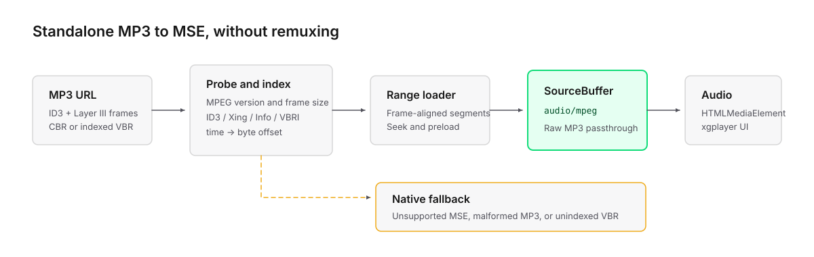

# xgplayer-mp3

English | [简体中文](./README.zh-CN.md)

`xgplayer-mp3` is an xgplayer streaming plugin for standalone MP3 files. It
loads data on demand with HTTP Range requests and provides MSE-based seeking
for CBR and indexed VBR files. When the runtime or input is unsupported, the
plugin falls back to native `<audio>` playback by default.

## Installation

```bash
npm install xgplayer xgplayer-mp3
```

Or:

```bash
yarn add xgplayer xgplayer-mp3
```

## Basic usage

```html
<div id="player"></div>
```

```js
import Player from 'xgplayer'
import MP3Plugin from 'xgplayer-mp3'
import 'xgplayer/dist/index.min.css'

const player = new Player({
  id: 'player',
  url: 'https://example.com/audio.mp3',
  mediaType: 'audio',
  plugins: [MP3Plugin]
})
```

When `mp3` options are omitted, the plugin uses its default buffering,
segmentation, and retry settings.

## HTTP Range and CORS

The server should support HTTP Range requests for on-demand loading and
seeking. A cross-origin `206` response should include headers similar to:

```http
HTTP/1.1 206 Partial Content
Content-Type: audio/mpeg
Accept-Ranges: bytes
Content-Range: bytes 0-131071/2892276
Access-Control-Allow-Origin: *
Access-Control-Expose-Headers: Content-Range, Content-Length, Accept-Ranges
```

If the server ignores the Range header and returns the complete file with
`200`, playback still works, but the entire file is downloaded and retained in
memory.

For a `206` response, JavaScript must be able to read a `Content-Range` header
that contains the complete file size. Otherwise, the plugin falls back to
native playback.

## Configuration

Pass plugin options through the player's `mp3` field:

```js
const player = new Player({
  // ...
  plugins: [MP3Plugin],
  mp3: {
    maxBufferLength: 60,
    bufferBehind: 20,
    segmentDuration: 15,
    timeout: 10000
  }
})
```

Common options:

| Option | Default | Description |
| --- | ---: | --- |
| `maxBufferLength` | `40` | Target forward buffer while playing, in seconds |
| `minBufferLength` | `5` | Target forward buffer while paused, in seconds |
| `bufferBehind` | `30` | Buffered history retained behind the current time, in seconds |
| `segmentDuration` | `10` | Target audio duration of each Range segment, in seconds |
| `retry` | `3` | Number of network retries |
| `retryDelay` | `1000` | Delay between retries, in milliseconds |
| `timeout` | `5000` | Timeout for one network request, in milliseconds |
| `reqOptions` | `null` | Request options such as method, headers, and credentials |
| `closeDowngrade` | `false` | Disable fallback to native playback after a fatal plugin error |

Advanced options:

| Option | Default | Description |
| --- | ---: | --- |
| `tickInterval` | `500` | Buffer scheduling interval, in milliseconds |
| `probeSize` | `131072` | Number of bytes used for the initial format probe |
| `maxProbeSize` | `1048576` | Maximum probe size when skipping a large ID3 tag |
| `syncSearchSize` | `4096` | Number of bytes searched backward for MP3 frame sync during seek |
| `preferMMS` | `false` | Prefer `ManagedMediaSource` when available |
| `mseAttachMode` | `'auto'` | MediaSource attachment mode: `auto`, `src`, or `source-element` |

`retryCount` is supported as an alias for `retry`.

## Supported inputs

`xgplayer-mp3` supports MPEG Audio Layer III only. Layer I and Layer II are
outside its supported scope.

| Capability | Status | Notes |
| --- | --- | --- |
| Standalone `.mp3` URL | Supported | HTTP(S), Blob URL, or a request that returns the complete file |
| MPEG-1 Audio Layer III | Supported | Common music MP3, 1152 samples per frame |
| MPEG-2 Audio Layer III | Supported | Low-sample-rate MP3, 576 samples per frame |
| MPEG-2.5 Audio Layer III | Supported | Widely supported unofficial extension, 576 samples per frame |
| CBR | Supported | Initial duration is estimated from file size and corrected after a complete linear scan |
| Xing / Info | Supported | Xing VBR requires a TOC; Info CBR uses frame and byte counts |
| VBRI VBR | Supported | Uses the VBRI table for seek mapping |
| VBR without Xing/Info/VBRI | Native fallback | Accurate Range seeking is not guaranteed without a complete scan |
| Free-format MP3 | Native fallback | The frame header has no standard indexed bitrate |
| ID3v1 / ID3v2 | Supported | Tags may appear before, after, or between audio frames |
| DRM / EME | Unsupported | Only clear MP3 files are handled |

AAC and ADTS are not MP3 and are not handled by this plugin. The plugin also
does not include a software decoder; decoding depends on the browser's
`audio/mpeg` support.

## Compatibility and fallback

Use the following check when runtime capability detection is required:

```js
if (MP3Plugin.isSupported()) {
  // audio/mpeg SourceBuffer is supported
}
```

Manual detection is usually unnecessary. The plugin restores the original URL
and playback state, then delegates to native `<audio>` playback when:

- The runtime does not support `audio/mpeg` MSE.
- The file is unsupported or has no reliable seek mapping.
- A fatal error occurs during MSE initialization, loading, or appending.

Set `closeDowngrade: true` to disable native fallback and emit a terminal player
error instead.

## MP3 format

MP3 is short for MPEG Audio Layer III. It is neither MPEG-3 nor a multitrack
container such as MP4:

```text
[optional ID3v2]
[MP3 Frame 1]
[MP3 Frame 2]
...
[optional ID3v1]
```

MPEG Audio Version and Layer are independent dimensions:

| MPEG Audio Version | Sample rates | Layer III samples per frame | Typical use |
| --- | --- | ---: | --- |
| MPEG-1 | 32 / 44.1 / 48 kHz | 1152 | Music and high-quality audio |
| MPEG-2 | 16 / 22.05 / 24 kHz | 576 | Speech and low-bandwidth audio |
| MPEG-2.5 | 8 / 11.025 / 12 kHz | 576 | Very low-bandwidth speech |

Version is a field in the MPEG Audio frame header and is unrelated to standard
families such as MPEG-4.

## How it works



The plugin probes ID3 data, MP3 frames, and Xing/Info/VBRI indexes. It then maps
playback time to byte positions and loads frame-aligned data through HTTP Range
requests.

`xgplayer-mp3` follows the
[MPEG Audio MSE Byte Stream Format](https://www.w3.org/TR/mse-byte-stream-format-mpeg-audio/).
It appends frame-aligned MP3 data directly to an `audio/mpeg` SourceBuffer
without remuxing it to MP4. As required by the specification, `audio/mpeg` is
used without a `codecs` parameter.

## Error identifiers

Fatal errors are reported through the `playCatch` event:

| `vtype` | Stage |
| --- | --- |
| `MP3_1` | Before the first data append completes |
| `MP3_2` | After the first data append completes |

With the default configuration, the plugin proceeds with native playback
fallback after emitting the event.
